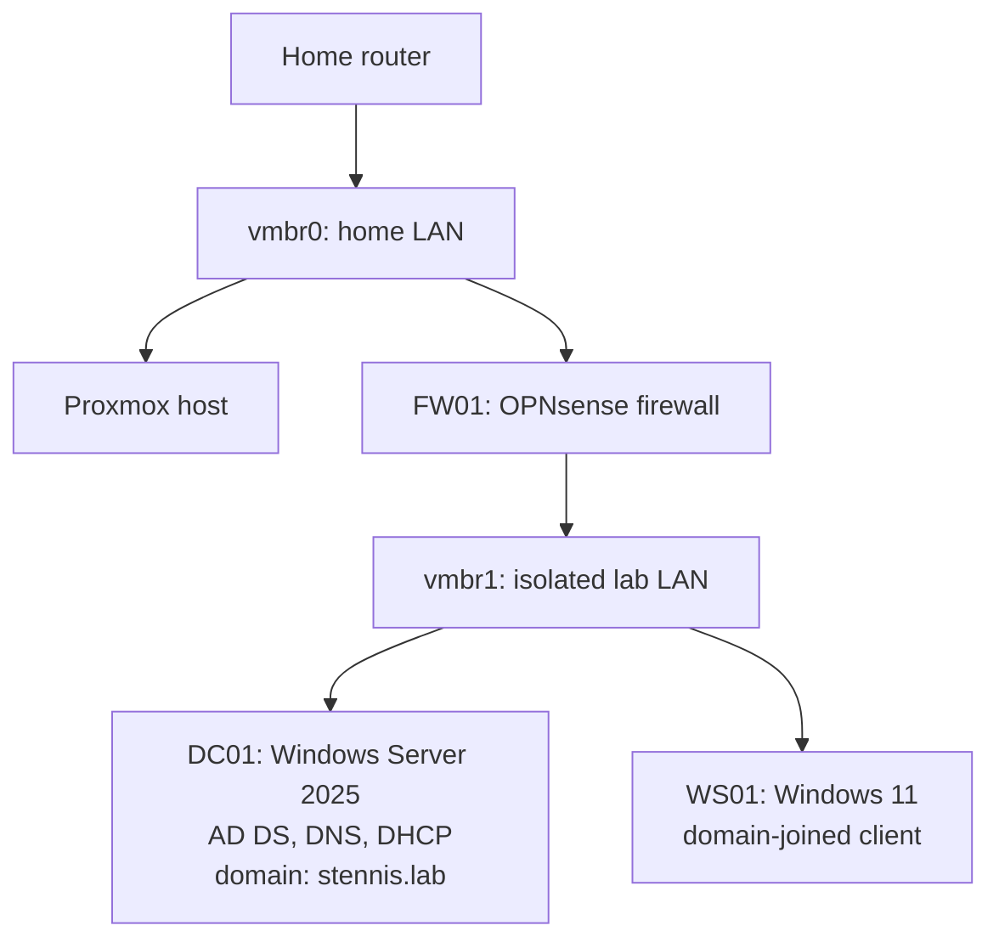

# Homelab

A Proxmox lab on a used Dell OptiPlex that I use to practice IT support and network infrastructure: building a Windows domain behind a firewall, then breaking it and fixing it the way a service desk would.

## Hardware
| Component | Details |
|---|---|
| Host | Dell OptiPlex 3060 SFF (i5-8500, 16GB RAM, 256GB NVMe) |
| Hypervisor | Proxmox VE 9.2 |
| Cost | ~$188 for the box, plus a used monitor and keyboard |

## Topology

## What's built
| VM | Role | Notes |
|---|---|---|
| FW01 | OPNsense firewall/router | WAN on vmbr0, LAN on vmbr1. Keeps the lab isolated from the home network |
| DC01 | Windows Server 2025 domain controller | AD DS, DNS, and DHCP for `stennis.lab` |
| WS01 | Windows 11 workstation | Joined to `stennis.lab`, gets its address from DC01 |

## Troubleshooting drills
Every drill is written up like a service desk ticket: what the user reported, how I narrowed it down, the root cause, and the fix. See [`/tickets`](tickets/).

| Ticket | Issue | Category |
|---|---|---|
| [LAB-001](tickets/LAB-001-corrupt-iso.md) | OPNsense install failing, ISO corrupt | Build / integrity |
| [LAB-002](tickets/LAB-002-dns-cached-credentials.md) | Domain issues hidden by cached credentials | DNS / AD |
| [LAB-003](tickets/LAB-003-dc-offline.md) | Domain controller offline | AD / availability |
| [LAB-004](tickets/LAB-004-dhcp-outage.md) | Clients not getting addresses | DHCP / network |
| [LAB-005](tickets/LAB-005-account-lockout.md) | User locked out | AD / accounts |

## Roadmap
- [ ] Group Policy: password policy, mapped drives, desktop restrictions
- [ ] BitLocker on WS01
- [ ] Windows reinstall/reimage drill
- [ ] PowerShell scripts for routine tasks (user creation, password resets)
- [ ] Network lab for CCNA practice (GNS3 with VyOS/FRRouting)

## Why
I'm building toward network and cloud infrastructure roles. This lab is where I practice the fundamentals those roles rest on (DNS, DHCP, directory services, firewalls) and get reps troubleshooting them.
